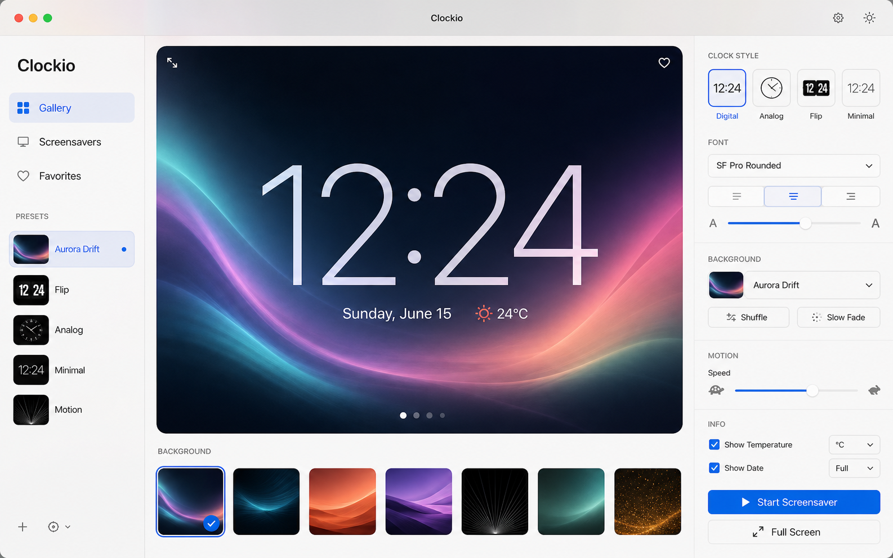

# Clockio

A native macOS clock and screensaver app, built with SwiftUI and AppKit. It shows the time in several clock styles over animated backgrounds, with the date, local temperature, and an optional to-do list.



*Design concept; the running app differs in detail.*

## Download

Get `Clockio.zip` from the [latest release](https://github.com/kritechno/clockio/releases/latest), unzip it and move `Clockio.app` to Applications. Requires an Apple Silicon Mac.

The app is not notarized by Apple, so macOS blocks the first launch. Right-click the app, choose Open, then confirm. On recent macOS versions you may instead need System Settings > Privacy & Security > Open Anyway.

## Privacy

Clockio has no account and no analytics. Settings and to-dos are stored locally in `~/Library/Application Support/Clockio`. If you allow location access, your coordinates are sent to [Open-Meteo](https://open-meteo.com) to fetch the temperature and sunrise and sunset times; nothing else leaves your Mac.

The previous Electron prototype has been superseded by the Swift package in this repository.

## Run

```bash
swift run Clockio
```

## Build Checks

The core behavior is covered by an assertion-based executable that works in Command Line Tools environments:

```bash
swift run ClockioCoreChecks
```

The package also keeps an optional XCTest target in `Tests/ClockioCoreTests` for full Xcode toolchains:

```bash
swift test --enable-xctest --disable-swift-testing
```

## Build The macOS App

```bash
scripts/build-macos-app.sh
open build/Clockio.app
```

The script builds the Swift release binary and creates:

```text
build/Clockio.app
```

## Snapshot Visual QA

The app binary includes an offscreen SwiftUI snapshot mode for visual inspection without screen-recording permission:

```bash
.build/arm64-apple-macosx/debug/Clockio --snapshot /tmp/clockio-gallery.png
.build/arm64-apple-macosx/debug/Clockio --snapshot /tmp/clockio-settings.png --settings
.build/arm64-apple-macosx/debug/Clockio --snapshot /tmp/clockio-screensaver.png --screensaver
.build/arm64-apple-macosx/debug/Clockio --snapshot /tmp/clockio-digital-todos.png --style digital --background silk --todos
.build/arm64-apple-macosx/debug/Clockio --snapshot-suite /tmp/clockio-todo-snapshots
```

The snapshot suite writes one clock-plus-to-do PNG per clock style and one screensaver PNG.

## Smoke Checks

The app binary also includes a temporary-directory to-do smoke test for add/edit/complete/restart persistence:

```bash
.build/arm64-apple-macosx/debug/Clockio --todo-smoke-test
```

## Migrated Features

- Native SwiftUI workspace with sidebar, preview, background rail, inspector, and settings.
- Native macOS traffic lights/window behavior through `NSWindow`.
- Menu bar status item with a custom Clockio template icon.
- Dock icon hiding through native app activation policy.
- Launch-at-login preference wired through `SMAppService` when running as a signed `.app` bundle.
- Idle timer using macOS system idle time.
- Automatic day/night that follows the device location's sunset and sunrise (via CoreLocation and Open-Meteo), falling back to a fixed evening window until the first lookup succeeds.
- Fullscreen multi-display screensaver windows with click/key exit only.
- Device-location temperature lookup via CoreLocation and Open-Meteo, cached for 15 minutes.
- Clock styles: Glass Digital, Date Sentence, Status Corner, Flip Panels, Soft Dial, Stacked, Terminal.
- Animated SwiftUI/Canvas backgrounds plus sharp Brush, Horizon, and a restrained Mist variant inspired by Clocks.app-style landscape gradients.
- Customizable palettes for every built-in background.
- Custom image import copied into Application Support and persisted with a stable app label and truncated source filename metadata.
- Settings persistence in `~/Library/Application Support/Clockio/settings.json`.
- Native To-Do workspace with quick add, completion controls, optional scheduled times, compact screensaver task rows, and separate `~/Library/Application Support/Clockio/todos.json` persistence.

## Archived Prototype

The old Electron/Vite prototype source has been moved to `archive/electron-prototype`. Generated web/Electron outputs and dependency folders were removed from the active project tree.

## License

MIT
